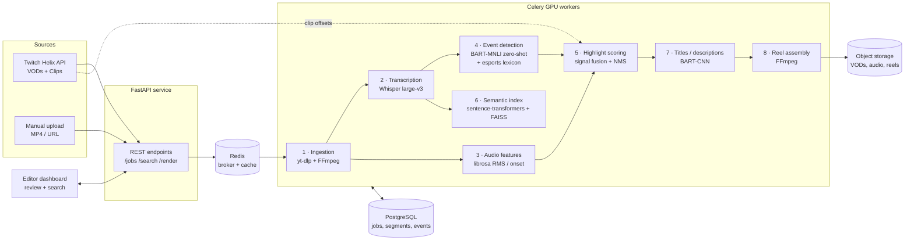

# 🎮 AI Esports Highlight Generator

> **Technical case study** of a production project I built as a Part-Time AI Developer at **Gamefy Academy** (Remote, 12/2025 – 02/2026).
> The source code is proprietary and covered by a confidentiality agreement, so this repository contains **no company code**. It documents the problem, the architecture, the ML pipeline, my engineering decisions and the measured results. The code snippets were written from scratch for this case study to show the approach.

---

 Turning a **3–4 hour Twitch VOD** into a **5-minute highlight reel** used to mean an editor scrubbing through the whole video by hand.

I built an **AI pipeline + FastAPI service** that:

1. **Pulls VODs and viewer clips** from the Twitch Helix API.
2. **Transcribes the caster commentary** with Whisper (speech-to-text with word-level timestamps).
3. **Detects key moments** by fusing three signals: audio excitement (loudness spikes), **zero-shot event classification with BART-MNLI**, and viewer clip density from Twitch.
4. **Indexes every moment for semantic search** with sentence-transformer embeddings, so editors can type *"ace on B site in round 18"* and jump straight to the timestamp.
5. **Assembles the highlight reel automatically** with FFmpeg (cuts, crossfades, loudness normalization, title cards), with **BART-CNN-generated titles and descriptions**.

**Impact:** manual highlight-review time went down by **~70%** (≈2h30 → ≈45 min per VOD). Editors now review a ranked shortlist of candidate clips instead of the whole broadcast.

---

## Architecture at a glance

---

## My role

I was the **only AI developer on the project**. I worked with a content lead (who wrote the requirements and signed off on quality) and two video editors (the end users who tested it).

I owned the project from the prototype notebook to the deployed service:

- Designed the end-to-end pipeline and the multi-signal highlight scoring.
- Integrated and tuned Whisper for noisy esports commentary (domain prompt, VAD, chunking).
- Built the zero-shot event detector (BART-MNLI) and the esports keyword lexicon.
- Built the semantic search layer (sentence-transformers + FAISS).
- Wrote the FastAPI service, the Celery job orchestration and the FFmpeg rendering module.
- Built the evaluation set together with the editors and measured precision, recall and time saved.

---

## Documentation

| Document | What's inside |
|---|---|
| [docs/01-problem-and-goals.md](docs/01-problem-and-goals.md) | Business context, the manual workflow it replaced, requirements and constraints |
| [docs/02-architecture.md](docs/02-architecture.md) | Components, data model, job lifecycle, API design, infrastructure |
| [docs/03-ml-pipeline.md](docs/03-ml-pipeline.md) | Step-by-step pipeline: ingestion → ASR → event detection → scoring → search → rendering |
| [docs/04-twitch-integration.md](docs/04-twitch-integration.md) | Twitch Helix API usage: auth, VOD/clip discovery, rate limits, clip offsets as weak labels |
| [docs/05-results-and-evaluation.md](docs/05-results-and-evaluation.md) | Evaluation method, metrics, benchmarks, ablation study |
| [docs/06-challenges-and-lessons.md](docs/06-challenges-and-lessons.md) | Hard problems I hit, how I solved them, what I'd do next |

---

## Key results

| Metric | Result |
|---|---|
| Manual highlight-review time per VOD | **−70%** (≈150 min → ≈45 min) |
| Processing time for a 3h VOD (single GPU) | **≈22 min** end-to-end (≈8× faster than real time) |
| Highlight recall vs. editor-picked moments | **0.84** |
| Precision of top-20 candidates | **0.78** |
| Semantic search hit rate (correct moment in top 5) | **0.88** |
| Whisper WER on caster commentary (with domain prompt) | **≈13%** (vs ≈19% without) |

See [docs/05-results-and-evaluation.md](docs/05-results-and-evaluation.md) for how these were measured.

---

## Tech stack

| Layer | Technologies |
|---|---|
| API & orchestration | Python 3.11, FastAPI, Pydantic v2, Celery, Redis |
| Speech-to-text | OpenAI Whisper (`large-v3` via Hugging Face Transformers), Silero VAD |
| NLP | Hugging Face Transformers: `facebook/bart-large-mnli` (zero-shot event classification), `facebook/bart-large-cnn` (summaries and titles) |
| Embeddings & search | `sentence-transformers` (`all-MiniLM-L6-v2`), FAISS |
| Audio / video | FFmpeg (`ffmpeg-python`), librosa, yt-dlp |
| Data | PostgreSQL (jobs, segments, events), S3-compatible object storage |
| External APIs | Twitch Helix API (OAuth2 client credentials) |
| Infra | Docker, NVIDIA Container Toolkit, GPU worker (24 GB VRAM) |
| Quality | pytest, a small labelled evaluation set, structured logging |

---
