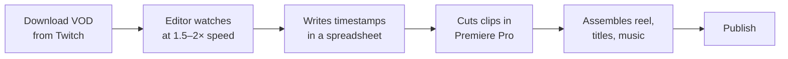

# 01 · Problem & Goals

## Business context

Gamefy Academy is an esports education and content platform. It streams tournaments, scrims and coaching sessions on Twitch, then reuses that footage as:

- **Highlight reels** (4–8 min) for YouTube,
- **Short vertical clips** (15–60 s) for TikTok, Instagram Reels and YouTube Shorts,
- **Teaching material**: key plays that coaches break down in lessons.

Each week produced roughly **10–15 hours of VODs** across several titles (mainly Valorant, League of Legends and EA FC).

## The manual workflow (before)

| Step | Time for one 3h VOD |
|---|---|
| Scrubbing the VOD and noting timestamps | ~2h00 – 2h30 |
| Cutting and assembling | ~1h00 |
| Titles, descriptions, export | ~20 min |

**Most of the time went into *finding* the moments, not editing them.** That made it the obvious place to automate.

## Goals

| # | Goal | Success criterion |
|---|---|---|
| G1 | Automatically surface the key moments of a match VOD | ≥ 80% of the moments an editor would pick are in the candidate list |
| G2 | Cut the time editors spend reviewing footage | ≥ 50% less review time (we reached **~70%**) |
| G3 | Let editors search a VOD by meaning, not only by timestamp | The correct moment is in the top 5 results for most natural-language queries |
| G4 | Produce a ready-to-publish draft reel automatically | 1080p MP4 with cuts, transitions, normalized audio and title cards |
| G5 | Fit the existing tooling | REST API that the content team's dashboard can call, and Twitch as the main source |

## Constraints

- **Small team, part-time timeline (3 months).** I had to rely on pretrained models (zero-shot, embeddings) and could not train large custom models from scratch.
- **Little labelled data.** There was no dataset of "highlight vs. not highlight". I used **Twitch viewer clips as weak labels** and built a small evaluation set with the editors.
- **Noisy audio.** Casters shout, talk over each other and over game sounds, and use a lot of jargon and player or agent names.
- **Several games.** The detection logic had to generalize across titles without one model per game.
- **One GPU.** The whole pipeline had to run on one 24 GB GPU machine at a reasonable speed (well under the VOD's real-time length).

## Non-goals

- Fully replacing the editor. The system **proposes** and the human **decides**. Final creative choices (music, pacing) stay manual.
- Live, real-time highlight detection during the stream. VOD post-processing was enough for the content calendar.
- Computer vision on the game feed (kill-feed OCR and similar). I considered it, but left it out of scope because it needs per-game work. See [lessons](06-challenges-and-lessons.md).
