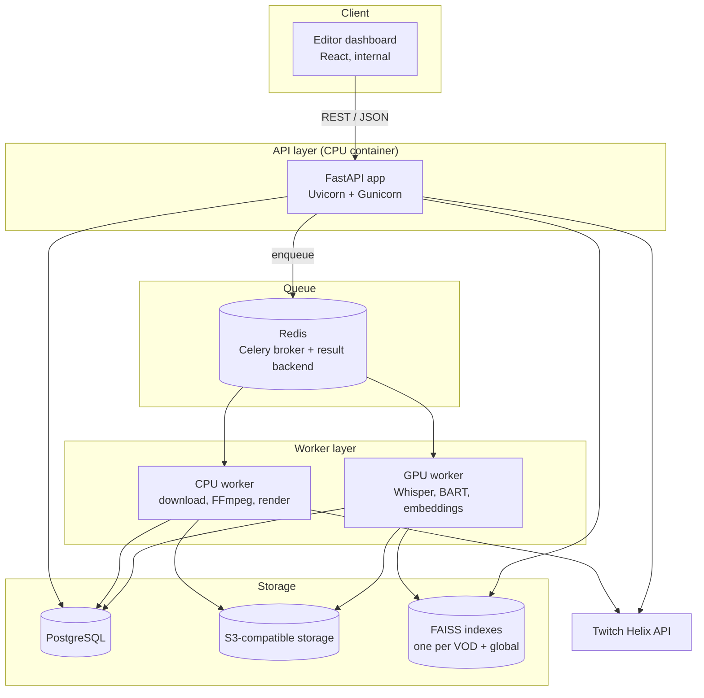
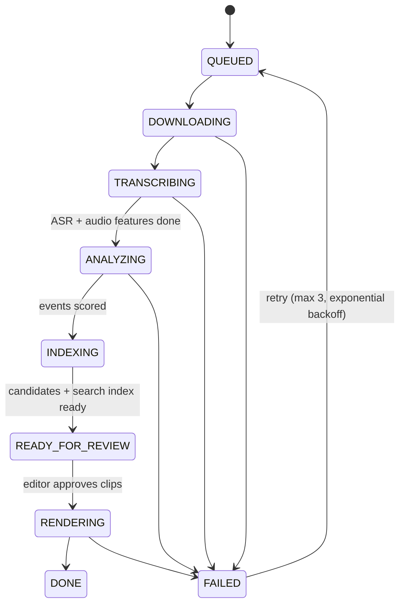
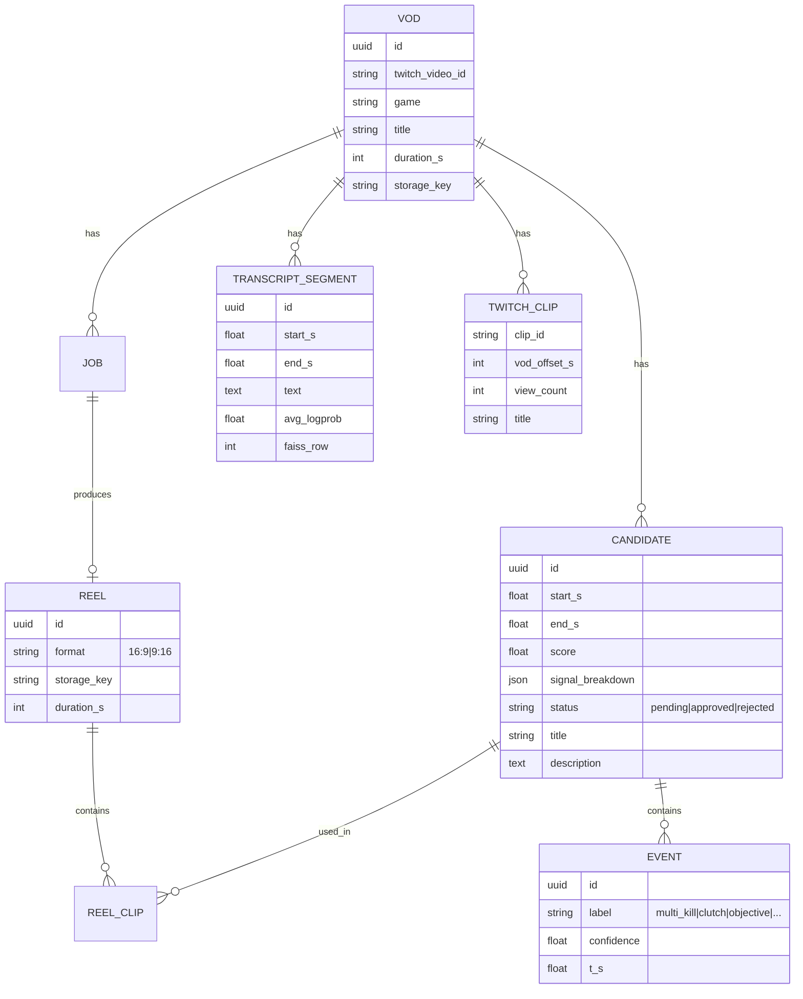

# 02 · System Architecture

## Components



### Why this layout

- **The API never runs heavy work.** Requests return in milliseconds with a `job_id`, and everything long runs on Celery workers.
- **Separate CPU and GPU queues.** Downloading and FFmpeg rendering are I/O- and CPU-bound. Whisper and the transformers are GPU-bound. With two queues (`cpu`, `gpu`), a render job never blocks transcription, and the GPU worker runs with `concurrency=1` to avoid out-of-memory errors.
- **Models load once per worker process** (in a `worker_process_init` hook) and stay in GPU memory. Loading Whisper `large-v3` cold takes ~20 s, so reloading it per task would have been wasteful.

## Job lifecycle



Every step is **idempotent** and writes its output to object storage under a deterministic key (`vods/{vod_id}/audio.wav`, `vods/{vod_id}/transcript.json`, …). A retried job skips steps whose output already exists. This saved a lot of GPU time when a late step such as rendering failed.

The pipeline is a Celery **chain**: `download → (transcribe ∥ audio_features) → detect_events → score → (index ∥ summarize)`. The `∥` parts run as a `group` and join in a `chord`.

## Data model (simplified)



`signal_breakdown` stores each signal's contribution to the score (audio, events, clips, keywords). The dashboard shows it, so editors can see **why** a moment was suggested. That transparency helped them trust the system.

Editor feedback (`approved` / `rejected`) is kept. I used it to re-tune the fusion weights (see [ML pipeline §5](03-ml-pipeline.md#5-highlight-scoring-signal-fusion)).

## REST API

| Method | Endpoint | Purpose |
|---|---|---|
| `POST` | `/v1/jobs` | Create a job from a Twitch video ID, a Twitch URL or an uploaded file |
| `GET` | `/v1/jobs/{job_id}` | Status, progress %, current step, errors |
| `GET` | `/v1/vods/{vod_id}/candidates?min_score=&limit=` | Ranked list of highlight candidates with their signal breakdown |
| `PATCH` | `/v1/candidates/{id}` | Approve or reject a candidate, or adjust its start and end |
| `POST` | `/v1/search` | Semantic search over one VOD or all VODs |
| `POST` | `/v1/vods/{vod_id}/render` | Render a reel from the approved candidates (`16:9` or `9:16`) |
| `GET` | `/v1/reels/{reel_id}` | Reel metadata and a pre-signed download URL |
| `POST` | `/v1/twitch/sync` | Pull the latest VODs and clips for the configured channels |
| `GET` | `/health`, `/metrics` | Liveness, and Prometheus metrics (queue depth, step durations) |

Example: creating a job

```http
POST /v1/jobs
Content-Type: application/json

{
  "source": "twitch",
  "twitch_video_id": "2054xxxxxx",
  "game": "valorant",
  "options": { "language": "en", "target_reel_minutes": 5, "vertical_shorts": true }
}
```

```json
{ "job_id": "8f1c…", "vod_id": "c2a7…", "status": "QUEUED" }
```

Example: semantic search

```http
POST /v1/search
{ "query": "ace on B site with the operator", "vod_id": "c2a7…", "top_k": 5 }
```

```json
[
  { "start_s": 6412.0, "end_s": 6431.5, "score": 0.71,
    "text": "…he's got the op, one, two, THREE, FOUR, THAT'S THE ACE ON B…",
    "candidate_id": "a91e…" }
]
```

## Infrastructure

- **Docker Compose** with five services: `api`, `worker-cpu`, `worker-gpu`, `redis`, `postgres`. Object storage was an S3-compatible bucket.
- The GPU worker runs on the **NVIDIA Container Toolkit** on a single 24 GB VRAM machine.
- Configuration with `pydantic-settings` (`.env`), and secrets (Twitch client secret, DB password) only in environment variables.
- **Observability:** structured JSON logs with `job_id` on every line, Prometheus counters and histograms for step duration, and Flower for watching Celery queues.
- **Testing:** unit tests for scoring, NMS and window merging (pure functions), and integration tests on a 10-minute fixture VOD that runs the full pipeline with small models (`whisper-tiny`, a distilled MNLI model) in CI.
