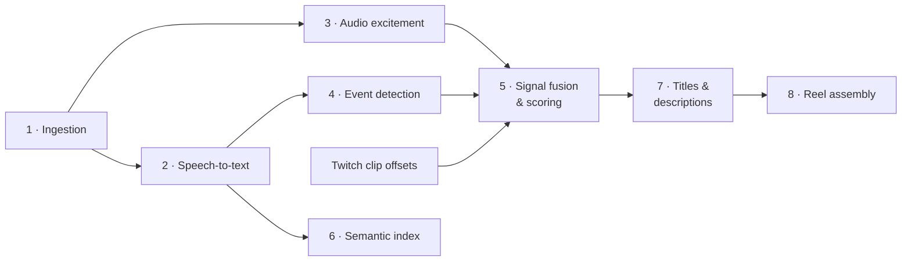

# 03 · The ML Pipeline, Step by Step



---

## 1. Ingestion

**Input:** a Twitch video ID (or URL / upload). **Output:** `video.mp4`, `audio.wav` (16 kHz mono), VOD metadata, and the list of Twitch clips for that VOD.

1. Get VOD metadata from Twitch (`GET /helix/videos?id=`): title, duration, channel, creation date. See [Twitch integration](04-twitch-integration.md).
2. Download the VOD with **yt-dlp**, in 720p to save bandwidth (the reel is re-rendered from the 1080p source only for the selected segments).
3. Extract the audio with FFmpeg:
   ```bash
   ffmpeg -i video.mp4 -vn -ac 1 -ar 16000 -c:a pcm_s16le audio.wav
   ```
4. Get every viewer-created clip for that VOD (`GET /helix/clips`), using each clip's `vod_offset` and `view_count`.

---

## 2. Speech-to-text (Whisper)

**Model:** `openai/whisper-large-v3` through the Hugging Face `transformers` ASR pipeline, in fp16 on GPU.

Steps:

1. **Voice Activity Detection (Silero VAD).** Remove long non-speech parts (menus, technical pauses, ad breaks). This cut the audio sent to Whisper by about **25–35%** on a typical tournament VOD.
2. **Chunked, batched inference.** 30 s chunks with 5 s stride overlap and `batch_size=16`, with `return_timestamps="word"` for word-level timing.
3. **Domain prompt.** I passed a prompt (`prompt_ids`) with game vocabulary: agent and champion names, abilities, maps, team and player names from the tournament bracket, and slang ("ace", "clutch", "1v3", "op", "baron steal"). This was the **single biggest accuracy win**: WER went from ≈19% to ≈13% on our evaluation clips.
4. **Hallucination guards.** Whisper sometimes repeats a phrase in loops over music or crowd noise. I dropped segments with `compression_ratio > 2.4` or `avg_logprob < -1.0`, and removed n-gram repetitions.
5. **Output:** a list of segments `{start, end, text, words[], avg_logprob}` stored in PostgreSQL and as JSON in object storage.

**Throughput:** about **10–12 min of GPU time for a 3-hour VOD** after VAD.

---

## 3. Audio excitement signal

When something big happens, casters get louder and faster and the crowd reacts. I turned that into a time series:

- **RMS energy** (librosa, 0.5 s hop), z-normalized per VOD so the score does not depend on stream volume.
- **Onset strength / spectral flux** as a proxy for sudden crowd or caster reactions.
- **Speech rate** (words per second from the Whisper word timestamps). Excited casting is faster.

The three signals are smoothed (Savitzky–Golay filter) and combined into one `audio_excitement(t)` in [0, 1].

---

## 4. Event detection (BART zero-shot + lexicon)

There was no labelled data to train a classifier, so I used **zero-shot classification with `facebook/bart-large-mnli`**. It frames each transcript window as an NLI problem: *"This text is about {label}."*

**Windows:** 10 s sliding windows over the transcript with 5 s overlap.

**Labels (shared by all games):**

| Label | Hypothesis template |
|---|---|
| `multi_kill` | "a player eliminated several enemies" |
| `clutch` | "a player won while outnumbered" |
| `objective` | "a team captured or destroyed an objective" |
| `round_or_game_win` | "a team won the round or the game" |
| `big_play` | "an impressive or skillful play happened" |
| `funny_moment` | "something funny or unexpected happened" |
| `filler` | "the casters are talking casually or analyzing" |

**Game-specific lexicon.** A YAML lexicon per game adds high-precision keyword hits, e.g. Valorant: `ace`, `spike planted`, `defused`, `1v[2-5]`, `operator`; LoL: `baron`, `pentakill`, `inhib`, `steal`; EA FC: `goal`, `penalty`, `red card`, `top bins`. Each pattern has a weight, and the lexicon score is capped so keywords alone can't make a highlight.

```python
# Illustrative snippet, written for this case study
from transformers import pipeline

zsc = pipeline("zero-shot-classification", model="facebook/bart-large-mnli",
               device=0, torch_dtype="float16")

LABELS = {
    "multi_kill": "a player eliminated several enemies",
    "clutch": "a player won while outnumbered",
    "objective": "a team captured or destroyed an objective",
    "round_or_game_win": "a team won the round or the game",
    "big_play": "an impressive or skillful play happened",
    "funny_moment": "something funny or unexpected happened",
    "filler": "the casters are talking casually or analyzing",
}

def classify_windows(windows: list[str]) -> list[dict[str, float]]:
    out = zsc(windows, candidate_labels=list(LABELS.values()),
              hypothesis_template="{}.", multi_label=True, batch_size=32)
    inv = {v: k for k, v in LABELS.items()}
    return [{inv[l]: s for l, s in zip(r["labels"], r["scores"])} for r in out]
```

`event_score(t) = max(non-filler label scores) − 0.5 × filler score`, clipped to [0, 1].

---

## 5. Highlight scoring (signal fusion)

Each 1 s time step gets a combined score:

```
score(t) = 0.35 · audio_excitement(t)
         + 0.35 · event_score(t)
         + 0.20 · clip_density(t)      # Twitch viewer clips around t, weighted by log(view_count)
         + 0.10 · lexicon_score(t)
```

The **initial weights** came from a small grid search on 6 labelled VODs. After the first month, I **re-fit them with logistic regression** on the editors' approve/reject feedback (~900 labelled candidates), which raised top-20 precision from 0.71 to 0.78.

**From a score curve to clips:**

1. **Peak detection** (`scipy.signal.find_peaks`) with a minimum prominence and 20 s minimum distance between peaks.
2. **Clip windows:** each peak becomes `[peak − 8 s, peak + 4 s]`, because the action usually happens *before* the casters react. The window is then extended to the nearest transcript sentence boundary so a clip never cuts mid-sentence.
3. **Non-maximum suppression and merging:** overlapping windows (IoU > 0.3) merge, and the higher score wins. Clips are capped at 45 s.
4. **Ranking:** candidates are sorted by score and the top N go to the editor (default 30 per 3h VOD).

```python
# Illustrative snippet, written for this case study
def merge_windows(cands, iou_thr=0.3, max_len=45.0):
    cands = sorted(cands, key=lambda c: c.score, reverse=True)
    kept = []
    for c in cands:
        overlap = next((k for k in kept if iou(c, k) > iou_thr), None)
        if overlap is None:
            kept.append(c)
        else:  # extend the stronger clip instead of keeping a near-duplicate
            overlap.start = max(min(overlap.start, c.start), overlap.end - max_len)
            overlap.end = min(max(overlap.end, c.end), overlap.start + max_len)
    return sorted(kept, key=lambda c: c.start)
```

---

## 6. Semantic search over transcripts

The goal was to let editors and coaches find moments **by meaning**, e.g. *"the Baron steal in game 2"* or *"when they talked about the eco round strategy"*.

- **Model:** `sentence-transformers/all-MiniLM-L6-v2` (384-dim). It is fast enough to embed a 3h transcript in under 30 s, and it was good enough on our queries. I compared it with `all-mpnet-base-v2`: +2 points of hit rate at about 5× the cost, so I didn't switch.
- **Units:** 20 s transcript windows with 50% overlap, plus each candidate's generated title and description (so titles become searchable too).
- **Index:** FAISS `IndexFlatIP` on L2-normalized vectors (cosine similarity). There is one index per VOD and one global index across all VODs. At our scale (tens of thousands of vectors), exact search took under 5 ms, so approximate indexes weren't needed.
- **Hybrid re-ranking:** final score = `0.8 · cosine + 0.2 · BM25` (rank-bm25). Pure embeddings sometimes missed exact player names, and BM25 fixed that.
- **Filters:** game, date range and channel, applied as metadata pre-filters before the vector search.

---

## 7. Titles & descriptions (BART-CNN)

For each approved candidate, `facebook/bart-large-cnn` summarizes the transcript text of that window plus 30 s of context into a one-line description. A short title is then built from the top event label, the main player name (matched against the bracket roster) and the summary, e.g.:

> **"Player X — 1v3 Clutch on B Site (Round 18)"**
> *"Down to the last player, X holds B site with the Operator and wins the round against three attackers."*

Editors could edit these, but most were kept as-is or only slightly changed.

---

## 8. Reel assembly (FFmpeg)

1. **Cut** each approved segment from the 1080p source. Re-encoding at segment boundaries keeps cuts frame-accurate (stream-copy cuts only on keyframes, which caused jumpy starts).
2. **Transitions:** 0.5 s `xfade` video crossfade and `acrossfade` audio.
3. **Title cards:** `drawtext` overlay with the generated title for the first 3 s of each clip.
4. **Audio:** EBU R128 loudness normalization (`loudnorm=I=-14:TP=-1.5:LRA=11`) to match YouTube's target loudness.
5. **Formats:**
   - `16:9` 1080p60 H.264 for YouTube,
   - optional `9:16` 1080×1920 shorts: center crop with a blurred-background pad for the parts of the frame outside the crop.
6. Upload to object storage and return a pre-signed URL.

A 5-minute reel renders in about **2–3 minutes** on CPU (`libx264 -preset veryfast`).
